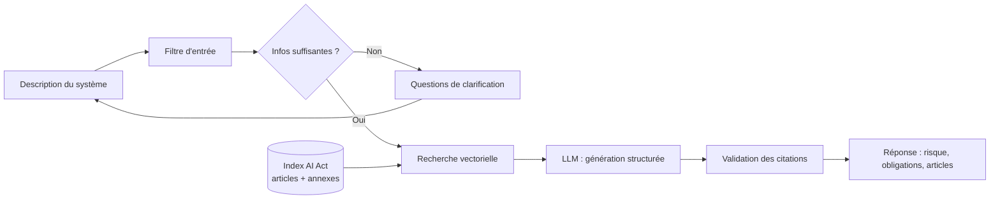

# 🇪🇺 Assistant de conformité AI Act (RAG)

> Décrivez votre système d'IA, obtenez son niveau de risque au sens de l'**AI Act européen (Règlement (UE) 2024/1689)**, les obligations qui s'appliquent et les **articles exacts** qui les justifient.


🔗 **Démo en ligne :** _à venir_

<!-- TODO : ajouter un GIF de démo ici -->
<!--  -->

---

## Pourquoi ce projet

L'AI Act impose des obligations très différentes selon le niveau de risque d'un système d'IA, mais le texte est long et technique. Cet assistant aide une entreprise à faire une **première évaluation** de son système, avec des réponses **traçables** : chaque affirmation renvoie aux articles du règlement sur lesquels elle s'appuie.

## Fonctionnalités

- **Classification du risque** : pratique interdite, haut risque, risque limité ou risque minimal
- **Obligations applicables** selon le niveau de risque
- **Citations vérifiables** : les articles cités sont affichés avec leur texte source
- **Questions de clarification** quand la description est trop vague pour conclure (domaine d'usage, utilisateurs, données biométriques, décisions automatisées…)
- **Protection contre le prompt injection** (voir [Sécurité](#-sécurité))

## Architecture



**Corpus** : texte officiel de l'AI Act (EUR-Lex), articles et annexes I et III.
**Chunking** : un chunk par article (ou par paragraphe pour les articles longs), avec en métadonnées le numéro d'article, son titre et son chapitre.

## Stack technique

| Composant | Choix |
|---|---|
| Langage | Python |
| Interface | Streamlit |
| Base vectorielle | ChromaDB / FAISS |
| Embeddings | _à préciser_ |
| LLM | _à préciser_ |
| Déploiement | Hugging Face Spaces / Streamlit Cloud |

## Installation

```bash
git clone https://github.com/AmineBnh21/<nom-du-repo>.git
cd <nom-du-repo>
pip install -r requirements.txt
```

Créer un fichier `.env` :

```
LLM_API_KEY=votre_clé
```

Construire l'index puis lancer l'application :

```bash
python scripts/build_index.py
streamlit run app.py
```

## Structure du projet

```
├── app.py                 # Interface Streamlit
├── data/                  # Texte de l'AI Act
├── scripts/
│   └── build_index.py     # Chunking + indexation
├── src/
│   ├── retrieval.py       # Recherche vectorielle
│   ├── generation.py      # Prompt et génération structurée
│   ├── clarification.py   # Détection des infos manquantes
│   └── security.py        # Filtre d'entrée, validation des citations
└── eval/
    ├── test_cases.json    # Cas normaux et adversariaux
    └── run_eval.py
```

## 📊 Évaluation

Jeu de test : 20-25 cas normaux (tirés de l'article 5 et de l'annexe III) et 10 cas adversariaux.

**Stratégies de chunking**

| Stratégie | Exactitude du niveau de risque | Rappel des articles attendus |
|---|---|---|
| Par article | _à venir_ | _à venir_ |
| Taille fixe + chevauchement | _à venir_ | _à venir_ |

**Résistance au prompt injection**

| Configuration | Attaques bloquées |
|---|---|
| Sans défenses | _à venir_ / 10 |
| Avec défenses | _à venir_ / 10 |

## 🔒 Sécurité

La description saisie par l'utilisateur est la principale source de risque (injection directe, tentatives de détournement). Défenses mises en place :

- **Séparation données / instructions** : la description est délimitée dans le prompt et traitée comme un texte à analyser, jamais comme des consignes
- **Sortie structurée** : niveau de risque choisi dans une liste fermée, réponse parsée en JSON
- **Validation des citations en code** : tout article cité doit exister dans les passages récupérés, sinon la réponse est rejetée
- **Filtre d'entrée** : limite de longueur, détection des injections évidentes et des demandes hors sujet
- **Protection du déploiement** : limite de requêtes par session et plafond de dépenses sur la clé API

Aucune défense contre le prompt injection n'est parfaite : ces mesures réduisent le risque sans l'éliminer.

## Limites

- **Ceci n'est pas un avis juridique.** L'outil fournit une première orientation, à valider par un juriste.
- Le corpus est figé à la date d'indexation et n'intègre pas les actes délégués, lignes directrices ou normes harmonisées publiés ensuite.
- La qualité de la classification dépend de la précision de la description fournie.

## Feuille de route

- [ ] Pipeline RAG de bout en bout
- [ ] Interface Streamlit
- [ ] Questions de clarification
- [ ] Défenses contre le prompt injection
- [ ] Déploiement
- [ ] Évaluation (chunking + sécurité)
- [ ] GIF de démo

## Auteur

**Mohamed Amine Benhamaid** · Master 2 Intelligence Artificielle
[GitHub](https://github.com/AmineBnh21) · [LinkedIn](https://www.linkedin.com/in/mohamed-amine-benhamaid)
