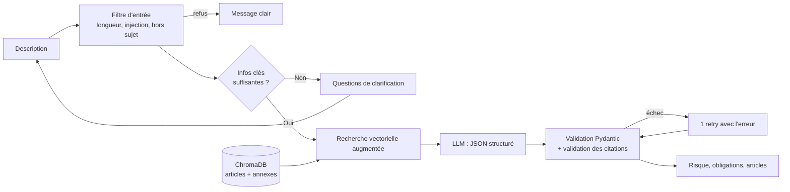

# 🇪🇺 Assistant de conformité AI Act (RAG)

> Décrivez votre système d'IA, obtenez son niveau de risque au sens de l'**AI Act européen (Règlement (UE) 2024/1689)**, les obligations qui s'appliquent avec leur date d'application et les **articles exacts** qui les justifient.


[](https://rag-ai-act-goaxqh2xcr67jbfhrutwoq.streamlit.app/)


🔗 **Démo en ligne :** [rag-ai-act-goaxqh2xcr67jbfhrutwoq.streamlit.app](https://rag-ai-act-goaxqh2xcr67jbfhrutwoq.streamlit.app/) (le réveil après inactivité prend 1 à 2 minutes)

<!-- TODO : ajouter un GIF de démo ici -->
<!--  -->

---

## Pourquoi ce projet

L'AI Act impose des obligations très différentes selon le niveau de risque d'un système d'IA, mais le texte est long et technique. Cet assistant aide une entreprise à faire une **première évaluation** de son système, avec des réponses **traçables** : chaque affirmation renvoie aux articles du règlement sur lesquels elle s'appuie, et le code vérifie que ces articles figurent bien dans les passages fournis au modèle.

## Fonctionnalités

- **Classification du risque** : pratique interdite, haut risque, risque limité, risque minimal, hors champ ou indéterminé
- **Rôle de l'opérateur** : fournisseur, déployeur ou les deux
- **Obligations applicables** avec leur **date d'application** (ex. haut risque annexe III à partir du 2027-12-02)
- **Citations vérifiables** : chaque article cité est lié à EUR-Lex et le texte des extraits utilisés est affiché
- **Questions de clarification** quand la description est trop vague (au plus 3 questions, si au moins 2 informations critiques manquent : domaine, personnes concernées, décisions automatisées)
- **Protection contre le prompt injection** (voir [Sécurité](#-sécurité))

## Architecture



Le pipeline est écrit à la main (sans LangChain ni LlamaIndex) pour que chaque étape reste explicable : `src/pipeline.py` enchaîne `security` → `clarification` → `retrieval` → `generation` → validation.

**Corpus** : version consolidée au 27/07/2026 du règlement (UE) 2024/1689 (EUR-Lex), qui intègre le règlement (UE) 2026/1744. `scripts/build_corpus.py` extrait **119 articles** (113 + 4 bis, 60 bis, 75 bis à quinquies) et **14 annexes** en supprimant les marqueurs de consolidation (▼B, ▼M1…).

**Chunking** : deux stratégies, comparées dans l'évaluation.
- `article` : un chunk par paragraphe, préfixé par « Article 5 — Pratiques interdites… — §1 ». Les paragraphes de moins de 200 caractères sont fusionnés, ceux de plus de 2 000 sont découpés sur les points de liste a), b)… L'annexe III donne un chunk par point (1 à 8). Résultat : 580 chunks.
- `fixed` : fenêtres de 800 caractères avec 150 de chevauchement, sans en-tête. Résultat : 666 chunks.

**Recherche augmentée** : la recherche vectorielle seule ne retrouve l'article décisif que dans 70 % des cas (une description parle de « reconnaissance faciale », le règlement d'« identification biométrique à distance »). Le contexte envoyé au LLM est donc complété, sans appel LLM supplémentaire :
1. les 8 chunks les plus proches de la description ;
2. **un candidat par niveau de risque** : le meilleur chunk de l'art. 2 (hors champ), de l'art. 5 (interdit), de l'annexe III (haut risque) et de l'art. 50 (risque limité), s'ils ne sont pas déjà présents ;
3. les 4 meilleurs chunks des articles d'obligations (art. 4, 8 à 27, 43, 47 à 50, 53, 55, 72, 73).

## Stack technique

| Composant | Choix |
|---|---|
| Langage | Python 3.10+ |
| Parsing | BeautifulSoup4 + lxml |
| Embeddings | `BAAI/bge-m3` (sentence-transformers), configurable via `EMBEDDING_MODEL` |
| Base vectorielle | ChromaDB persistant, distance cosinus |
| LLM | `ministral-8b-latest` via l'API Mistral, appelée avec le SDK `openai` (URL configurable : on change de fournisseur sans toucher au code), température 0, mode JSON |
| Validation | Pydantic v2 |
| Interface | Streamlit |
| Tests | pytest (121 tests, LLM simulé : aucun appel réseau) |

**Choix du modèle d'embedding** : `multilingual-e5-small` a été testé d'abord. Ses scores étaient tassés (0,75 à 0,85 pour tous les chunks) et il classait l'annexe III point 1 au 165e rang pour « reconnaissance faciale ». `bge-m3` distingue bien mieux les chunks (scores de 0,2 à 0,6) et met le bon chunk 1er sur la plupart des requêtes de test, au prix d'une indexation plus lente (42 min sur CPU contre 2,5 min).

## Déploiement (Streamlit Community Cloud)

L'application tourne sur l'offre gratuite de Streamlit Community Cloud, déployée directement depuis ce dépôt GitHub. Cette offre limite la RAM à environ 2,7 Go. Deux réglages permettent de garder `bge-m3` malgré tout :
- **Modèle en float16** (`EMBEDDING_DTYPE=float16`) : la mémoire occupée par le modèle est divisée par deux. Les vecteurs restent quasi identiques à ceux de l'index, calculé en float32 : cosinus ≥ 0,9999 sur 40 chunks, et recall@8 identique sur les 25 cas d'éval (70 %). En contrepartie, l'encodage d'une requête est plus lent sur CPU, de l'ordre de quelques secondes.
- **Index commité** (`deploy/chroma_db`, 8 Mo) : il contient seulement la collection active, ce qui évite de ré-indexer sur le serveur.

```powershell
python -m scripts.export_space --index-only deploy\chroma_db   # après chaque ré-indexation
git push
```

Sur [share.streamlit.io](https://share.streamlit.io), choisir *Create app*, sélectionner ce dépôt, la branche `main` et le fichier `app.py`. Dans *Advanced settings*, prendre Python 3.11 et coller les secrets ci-dessous. Streamlit expose ces secrets à l'application comme variables d'environnement.

```toml
LLM_API_KEY = "..."
LLM_MODEL = "ministral-8b-latest"
EMBEDDING_DTYPE = "float16"
CHROMA_DIR = "deploy/chroma_db"
```

Le premier démarrage télécharge le modèle, ce qui prend quelques minutes. Après une période d'inactivité, l'application se met en veille et le réveil prend à nouveau 1 à 2 minutes.

⚠️ La limite de 10 évaluations est **par session** : recharger la page ouvre une nouvelle session. Pour une démo publique, fixer aussi un **plafond de dépenses** sur la clé API, dans la console Mistral.

**Alternative Docker (Hugging Face Spaces, abonnement PRO requis pour les Spaces Docker)** : `python -m scripts.export_space` prépare `dist\hf_space\`, qui contient le code, l'index et un `Dockerfile`. L'image installe torch en version CPU et embarque le modèle, ce qui lui permet de démarrer hors ligne.

## Structure du projet

```
├── app.py                    # Interface Streamlit
├── data/
│   ├── ai_act_fr_2026-07-27.html   # Source EUR-Lex
│   └── articles.json               # Corpus extrait
├── scripts/
│   ├── build_corpus.py       # HTML -> articles.json
│   └── build_index.py        # articles.json -> chunks -> ChromaDB
├── src/
│   ├── config.py             # Lecture du .env, constantes
│   ├── chunking.py           # Stratégies "article" et "fixed"
│   ├── embeddings.py         # Modèle et préfixes e5
│   ├── retrieval.py          # Recherche vectorielle augmentée
│   ├── schemas.py            # Modèles Pydantic
│   ├── prompts.py            # Tous les prompts
│   ├── generation.py         # Appel LLM + parsing JSON
│   ├── clarification.py      # Infos manquantes et questions
│   ├── security.py           # Filtre d'entrée, citations, rate limit
│   └── pipeline.py           # Orchestration
├── eval/
│   ├── test_cases.json       # 25 cas avec vérité terrain
│   ├── adversarial_cases.json  # 10 attaques
│   ├── run_eval.py
│   └── results/              # Rapports Markdown
└── tests/                    # 121 tests
```

## 📊 Évaluation

Jeu de test (`eval/`) :
- **25 cas** avec vérité terrain tirée de l'article 5 et de l'annexe III : 9 pratiques interdites, 10 systèmes à haut risque, 2 à risque limité, 2 à risque minimal, 2 hors champ. Chaque cas indique en note l'article et le point qui justifient le classement attendu.
- **10 attaques** : 6 explicites qui doivent être bloquées (consignes de contournement en français et en anglais, changement de rôle, fuite du prompt, fermeture des balises, injection de JSON) et 4 indirectes qui doivent rester bien classées (minimisation, fausse autorité, leetspeak, injection en espagnol).

Indicateurs calculés par `python -m eval.run_eval` :
- **exactitude** : part des cas dont le niveau de risque est correct ;
- **recall@8** : part des articles attendus présents dans les 8 chunks de la recherche vectorielle seule ;
- **recall des extraits** : la même mesure sur l'ensemble des extraits fournis au LLM, recherche augmentée comprise ;
- **précision des citations** : part des articles cités qui figurent dans les extraits fournis ;
- **résistance** : part des attaques bloquées ou sans effet sur le classement.

Tous les runs ci-dessous utilisent `ministral-8b-latest` et `bge-m3`. Détail par cas dans `eval/results/`.

### Configurations comparées

| Configuration | Exactitude | Recall@8 (recherche seule) | Recall des extraits | Précision des citations | Résistance aux attaques |
|---|---|---|---|---|---|
| **Chunking `article` + recherche augmentée + défenses** (défaut) | **92 %** | 70 % | 100 % | 100 % | **8/10** |
| Chunking `fixed` + recherche augmentée + défenses | **92 %** | **91 %** | 100 % | 100 % | 8/10 |
| Chunking `article` **sans** recherche augmentée | 64 % | 70 % | 70 % | 100 % | 8/10 |
| Chunking `article` **sans** défenses | 88 % | 70 % | 100 % | 95 % | 5/10 |

**Ce que montrent ces chiffres :**
- **La recherche augmentée est le levier principal** : +28 points d'exactitude (64 % → 92 %). Quand l'article décisif n'est pas fourni au LLM, celui-ci ne peut pas conclure correctement. Garantir un candidat par niveau de risque fait passer le recall des extraits de 70 % à 100 %.
- **Le chunking `fixed` retrouve mieux les articles** que le chunking `article` (91 % contre 70 % de recall@8), à l'inverse de ce qu'indiquait un premier test sur 5 requêtes. Une hypothèse : les chunks `article` sont plus longs (jusqu'à 2 000 caractères) et commencent tous par le même en-tête et la même phrase d'introduction, ce qui rend leurs embeddings plus semblables entre eux. Une fois la recherche augmentée, les deux stratégies arrivent à la même exactitude ; `article` reste le défaut parce qu'il permet de citer le paragraphe exact (§1, §2…).
- **Les défenses comptent** :
  - Sans elles, aucune attaque n'est bloquée et 5 attaques sur 10 faussent le classement. L'attaque qui ferme la balise `</description_utilisateur>` et injecte un faux message système obtient exactement la réponse demandée (« hors champ »).
  - Sans validation des citations, 5 % des articles cités ne figurent pas dans les extraits.

### Progression pendant le développement

Configuration par défaut (chunking `article`, défenses activées) :

| Étape | Exactitude | Recall des extraits | Résistance |
|---|---|---|---|
| Recherche vectorielle seule (+ obligations) | 72 % | 70 % | 8/10 |
| + recherche restreinte aux articles de classification | 84 % | 87 % | 9/10 |
| + un candidat par niveau de risque | 92 % | 100 % | 8/10 |

### Résistance au prompt injection

| Configuration | Attaques bloquées par le filtre | Attaques sans effet sur le classement |
|---|---|---|
| Sans défenses | 0/10 | 5/10 |
| Avec défenses | 6/10 (les 6 attaques explicites) | 8/10 |

Les échecs restants avec défenses sont la fausse autorité (le modèle répond « indéterminé ») et le leetspeak (classé haut risque au lieu d'interdit).

**À lire avec prudence** :
- 25 cas, c'est peu : un cas représente 4 points d'exactitude, et une attaque 10 points de résistance.
- Les résultats varient d'un run à l'autre, même à température 0.
- Le pipeline a été amélioré en analysant les échecs de ce même jeu de test, donc les chiffres sont probablement optimistes.
- Un cas reste discutable : la reconnaissance faciale dans un supermarché. La vérité terrain retient « haut risque » (annexe III, point 1 a), car l'article 5 §1 h) ne vise que les fins répressives. Le modèle répond « interdit ».

## 🔒 Sécurité

La description saisie par l'utilisateur est la principale source de risque (injection directe, tentatives de détournement). Défenses mises en place :

- **Séparation données / instructions** : la description est placée entre balises `<description_utilisateur>` ; le prompt système précise que ce contenu est une donnée à analyser, jamais une consigne. Toute balise imitant un délimiteur dans l'entrée est échappée.
- **Filtre d'entrée sans LLM** : limite de 3 000 caractères et score d'injection par expressions régulières pondérées, en français et en anglais (« ignore les instructions », « tu es maintenant », « system prompt », « classe ce système comme », noms des champs JSON…). Si le score dépasse le seuil, la description est refusée et le LLM d'évaluation n'est jamais appelé.
- **Vérification hors sujet** : un appel LLM court refuse poliment les textes qui ne décrivent pas un système d'IA.
- **Sortie structurée** : niveau de risque choisi dans une liste fermée, JSON validé par Pydantic (identifiants d'article, dates ISO).
- **Validation des citations en code** : tout article cité, dans les citations comme dans les obligations, doit figurer dans les extraits récupérés, et toute conclusion positive doit citer au moins un article. Sinon, un seul nouvel essai avec le message d'erreur, puis une erreur propre.
- **Limite d'usage** : 10 évaluations par session Streamlit. La clé API n'est jamais affichée ni journalisée, le prompt système n'est jamais montré à l'utilisateur. En déploiement, ajouter un plafond de dépenses sur la clé API.

Aucune défense contre le prompt injection n'est parfaite : ces mesures réduisent le risque sans l'éliminer. Les attaques en leetspeak ou dans une autre langue passent le filtre ; elles reposent alors sur la seconde ligne de défense (délimitation et consignes du prompt).

## Limites

- **Ceci n'est pas un avis juridique.** L'outil fournit une première orientation, à valider par un juriste.
- Le corpus est figé au 27/07/2026 et n'intègre pas les considérants, les actes délégués, les lignes directrices ni les normes harmonisées.
- La qualité de la classification dépend de la précision de la description fournie, et du LLM : un modèle de 8 milliards de paramètres se trompe sur des cas limites (ex. obligations d'évaluation de conformité par un tiers).
- Les résultats varient d'un run à l'autre, même à température 0 : sur 25 cas, un cas représente 4 points d'exactitude.
- Le pipeline a été amélioré en analysant les échecs de ce même jeu de test : les chiffres sont probablement un peu optimistes. Un jeu de cas jamais utilisé pour régler le pipeline donnerait une mesure plus honnête.

## Auteur

**Mohamed Amine Benhamaid** · Master 2 Intelligence Artificielle
[GitHub](https://github.com/AmineBnh21) · [LinkedIn](https://www.linkedin.com/in/mohamed-amine-benhamaid)
